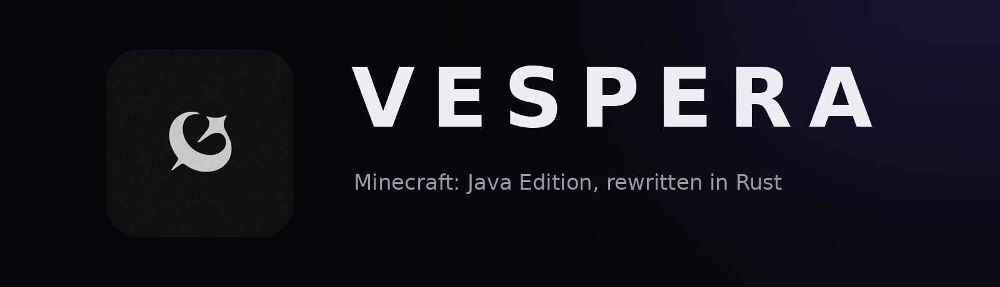

<p align="center">
  
</p>

<p align="center">
  
  
  
  
  <a href="LICENSE"></a>
</p>

<p align="center">
  <a href="#download"><b>Download</b></a> ·
  <a href="#the-launcher"><b>The launcher</b></a> ·
  <a href="#what-works-today"><b>What works</b></a> ·
  <a href="#host-a-server"><b>Host a server</b></a> ·
  <a href="#agent-control"><b>Agent control</b></a> ·
  <a href="#build-from-source"><b>Build from source</b></a>
</p>

# Vespera

**Vespera** is a launcher for Minecraft: Java Edition 26.3 rewritten in Rust: a native game that reads the same worlds, follows the same rules and generates the same terrain as the Java game, checked against it by 281 differential harnesses. You play it through the Vespera launcher, on the files from your own copy of Minecraft. It is free, open source and unofficial.

> **Based on [Horizon](https://github.com/horizon-rust/horizon)** by [Ludovic Marie](https://github.com/ludovic111) — Vespera carries the Horizon launcher and game forward under its own name. The engine keeps its Horizon identity in code and in the mod ecosystem; the product you install and see is Vespera.
>
> Not an official Minecraft product. Not approved by or associated with Mojang or Microsoft. Vespera contains no Minecraft code, assets or data: you need your own legally obtained copy of Minecraft: Java Edition 26.3.

## Download

Vespera is installed through **the Vespera launcher**. Grab a build from [the launcher releases](https://github.com/mel0k1/Vespera/releases?q=launcher&expanded=true) for Linux x86-64, macOS on Apple Silicon or Windows x64. The launcher installs and updates the game, prepares its files from your own copy of Minecraft, and updates itself.

**You need** a Microsoft account that owns Minecraft: Java Edition (the launcher signs in with it, as other launchers do); Minecraft: Java Edition 26.3, played once (the official launcher, Prism, MultiMC and other launchers all work); a Java 25 runtime, for the one-time preparation; and a GPU with Vulkan on Linux and Windows, or any Apple Silicon Mac.

## The launcher

Built with [GPUI](https://www.gpui.rs), Zed's UI framework — native, fast, dark by default, with Vespera's twilight violet.

- **Play** — prepares the game from your own Minecraft install, or downloads the pinned version straight from Mojang's own servers (piston-meta, with every file's size and sha1 checked) for an account that owns the game. Then starts the client.
- **Versions** — lists the published releases of this repository, installs the build for this platform into its own folder, and removes it again. Signed checksums are verified before anything runs.
- **Mods** — search Modrinth for resource packs and modpacks, each marked *Works*, *Partly* or *Doesn't run*; Java mod jars are never offered. Installs only after a SHA-512 match, with Update all and Remove.
- **Modpacks** — import a Modrinth `.mrpack`, a CurseForge zip or a Prism/MultiMC instance folder and see a per-mod coverage report. **Port** carries content mods over the player's own way — nothing is uploaded or shared.
- **Servers** — host a world for friends with buttons: create, start, stop, back up, update, a console, players, settings and **friends over the internet** through Tailscale. Everything goes through `horizon-server` itself.
- **Instances** — separate game folders with their own worlds, options and packs, grouped in the sidebar, with per-instance launch options, play time and export to `.mrpack` or a zip. Drop a file anywhere in the window to import it.
- **Accounts** — Microsoft sign-in, secrets kept in the system keychain.
- **Agents** — a built-in MCP server and CLI (`vespera-launcher mcp`, `vespera-launcher …`) so AI agents and scripts can drive the launcher, and `horizon-ctl` plays the game itself.
- **Self-update** — the launcher updates itself from this repository, through signed release checksums.

## What works today

The Rust engine keeps Horizon's audit: **every subsystem matches vanilla in every harness that compares it** — world generation, redstone, mobs and villagers, raids, every command, the HUD and recipe book, resource and data packs, saves from 1.8 to 26.2 upgraded as vanilla does, and joining vanilla servers. The full status table lives in [the upstream README](https://github.com/horizon-rust/horizon#project-status).

- **The game:** singleplayer on saves in vanilla's format, with vanilla's world generation and rules.
- **Horizon's extras:** graphics presets, distant terrain up to 1024 chunks, controller support, optional zoom, minimap and more — off by default where they would change the vanilla look.
- **Mods:** Horizon's own mod system (Rust compiled to WebAssembly). Java mod jars do not run.

Screenshots, captured in the Rust client itself with vanilla assets and no mods or shaders:

<table>
  <tr>
    <td colspan="2"></td>
  </tr>
  <tr>
    <td width="50%"></td>
    <td width="50%"></td>
  </tr>
</table>

## Host a server

The launcher's **Servers** page creates, starts, backs up and updates a Vespera server with buttons, and invites friends over Tailscale. On a VPS, `horizon-server` installs with one command and runs without Java.

## Agent control

AI agents and scripts can play the game. `horizon-ctl`, shipped beside it in every release folder, is a command line that reads the game as JSON and acts like a player; `horizon-ctl mcp` serves the same commands as an MCP server.

```sh
horizon-ctl launch --world Survival --seed 5 --wait   # finds the version the launcher installed
horizon-ctl state                                       # position, health, food, target, screen...
horizon-ctl find-block birch_log                        # the nearest logs
horizon-ctl goto -0.5 65 -2.5 --near 2.5                # walks there along a path
horizon-ctl break -1 65 -3                              # mines it; replies with the drops
horizon-ctl open-inventory && horizon-ctl click-slot 0  # menus: slots, buttons by label, text fields
```

Commands block until the action is done and reply with what happened; errors are JSON with distinct exit codes. See [docs/agent-control.md](docs/agent-control.md).

## Build from source

Requirements: Rust 1.90 or newer, Python 3.10 or newer, JDK 25, and on Linux the ALSA and udev development headers (`libasound2-dev libudev-dev` on Debian and Ubuntu).

Vespera contains no game files and never downloads them for itself. It builds its resources from **your own copy** of Minecraft: Java Edition 26.3, verified against the checksums in `research-lock.json`:

1. **Client:** install Java Edition with the official launcher and play 26.3 once. Vespera reads `versions/26.3/`, `libraries/` and `assets/` from the launcher's game directory (`~/.minecraft` on Linux). If yours lives elsewhere, pass `--minecraft-dir` or set `HORIZON_MINECRAFT_DIR`.
2. **Server jar:** the 26.3 server jar, from the `downloads.server.url` in your launcher's `versions/26.3/26.3.json` (or [minecraft.net/download/server](https://www.minecraft.net/en-us/download/server) while 26.3 is the current release). Pass it with `--server-jar` or set `HORIZON_SERVER_JAR`. It is only needed the first time.

```sh
git clone https://github.com/mel0k1/Vespera.git
cd Vespera
cargo run --release -p horizon-prepare -- --prepare --server-jar ~/Downloads/server.jar   # needs JDK 25
cargo run --release -p horizon-prepare -- sounds   # optional: sounds from your launcher install
cargo run --release -p horizon-client
```

The launcher itself:

```sh
cd launcher
cargo run --release
```

## For maintainers

Publishing releases is wired end to end ([docs/security.md](docs/security.md), [docs/upstream-sync.md](docs/upstream-sync.md)):

- **Release signing (done):** the `release` environment holds `RELEASE_SIGNING_KEY`, the private half of the Ed25519 pair whose public half is `crates/horizon-release-sign/release-keys.txt`; `tools/ci/sign_release.sh` signs a release's checksums, and every download checks them. To rotate: add a new public key as a second line, set the new private key as `RELEASE_SIGNING_KEY_NEXT`, release once, then swap the two secrets.
- **Microsoft sign-in:** the launcher reads `HORIZON_MSA_CLIENT_ID` ([docs/microsoft-account.md](docs/microsoft-account.md)). Register your own Azure app, allow public client flows, then set the repository variable: `gh variable set HORIZON_MSA_CLIENT_ID --body "<client-id>"`. Unset, the launcher says sign-in is not configured.
- **CurseForge search (optional):** an API key as the `HORIZON_CURSEFORGE_API_KEY` secret. Without it, the mod browser searches Modrinth only.
- **macOS builds:** `MAC_RUNNER` is set to `macos-latest`; for notarization, set `MACOS_SIGN_IDENTITY`. The automatic release trains are paused (`RELEASES_PAUSED=1`); change the variable to run them.
- **Upstream sync:** a weekly workflow merges Horizon's main into ours; the policy is in [docs/upstream-sync.md](docs/upstream-sync.md).

## Roadmap

- **Now:** keep the fork in sync with upstream Horizon, ship the first signed launcher and game releases here.
- **Next:** Vespera's own visual identity in-game, its own mod registry, a website.
- **UI:** the launcher stays on GPUI; its navigation lives in the floating dock (`launcher/src/dock.rs`).

## Credits

- [Horizon](https://github.com/horizon-rust/horizon) by [Ludovic Marie](https://lu4ovic.com) ([@ludovic111](https://github.com/ludovic111)) — the native Rust rewrite of Minecraft and the launcher Vespera is built on. The vast majority of this repository is Horizon's work; thank you.
- The Vespera launcher branding, icon and theme accent: mel0k1.

## Licence

[MIT](LICENSE), for the project's original work only. Dependencies keep their own licences. Minecraft is a trademark of Mojang Synergies AB; Minecraft code and assets belong to Mojang and Microsoft and are covered by the [Minecraft EULA](https://www.minecraft.net/en-us/eula). Decompiled game source and prepared resources stay on your machine and are never published.

Third-party credits and licenses: [Third-party notices](THIRD_PARTY_NOTICES.md).
